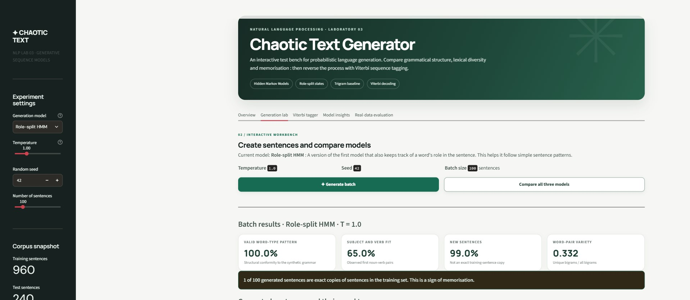
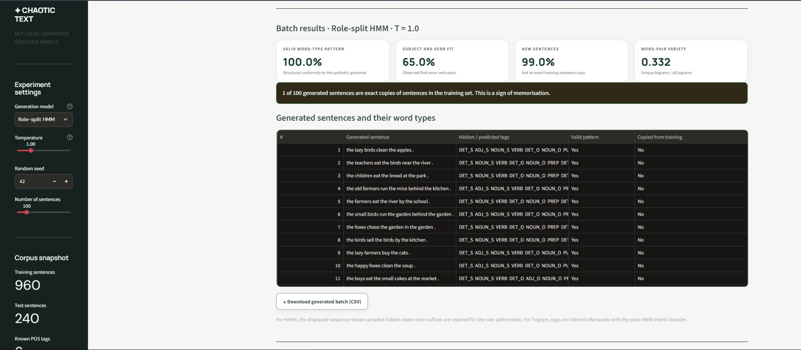
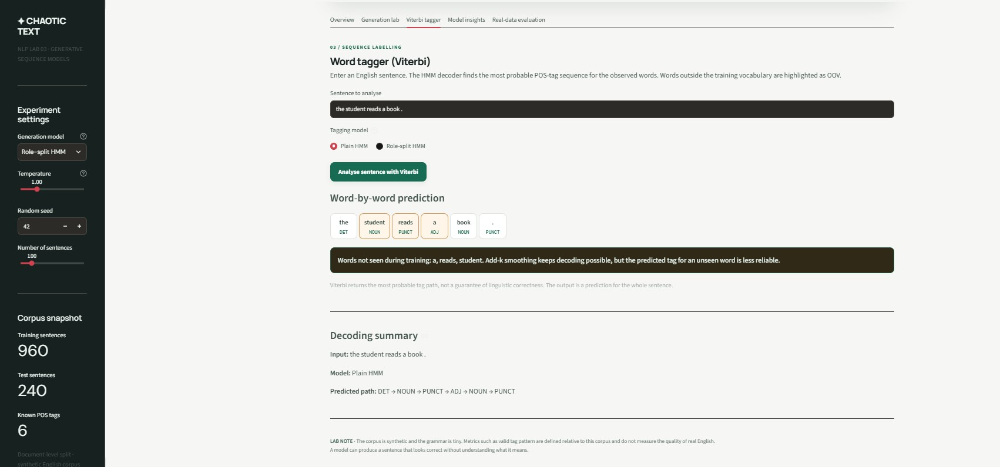
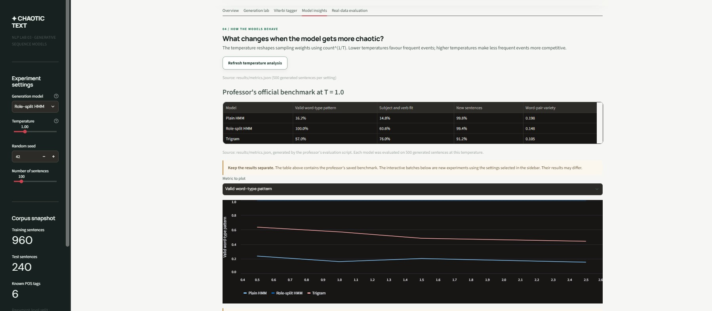
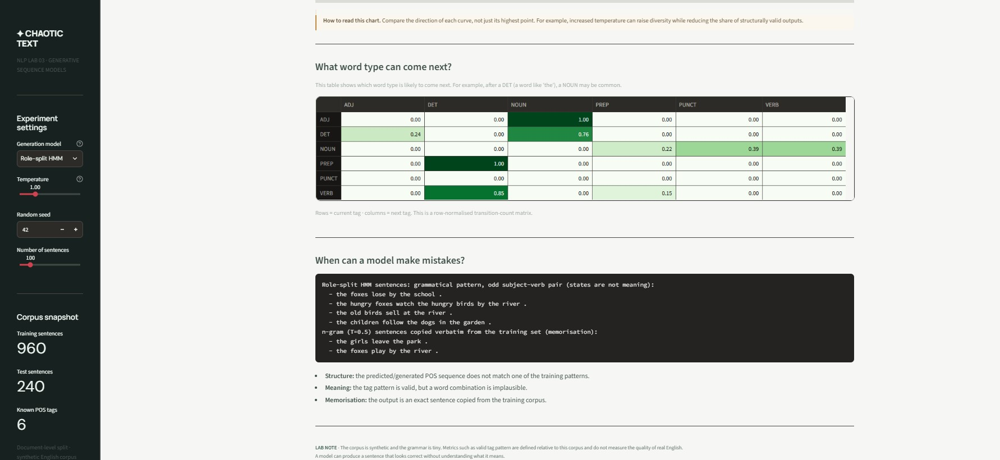
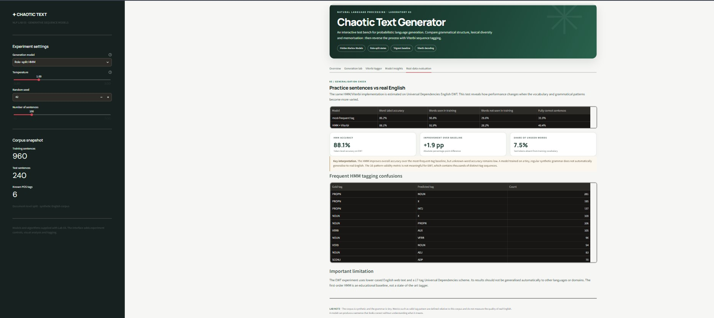

# Lab 03: Chaotic Text Generator

[]([YOUR_STREAMLIT_CLOUD_URL_HERE](https://chaotic-text-generator-app.streamlit.app/))

An interactive NLP workbench for probabilistic generative sequence models (POS-HMM, Role-Split HMM, and Trigram Baseline) and Viterbi sequence tagging.

---

## 🌐 Live Application & Deployment

The application is deployed on Streamlit Community Cloud and can be accessed online:
- **Live Demo:** [Click here to launch the application]([YOUR_STREAMLIT_CLOUD_URL_HERE](https://chaotic-text-generator-app.streamlit.app/))

---

## 📸 Application Screenshots

### 1. Interactive Workbench & Batch Generation

*Batch sentence generation displaying real-time structural metrics, novelty scores, and exact training match alerts.*

### 2. Sentence Details & Batch Analysis

*Detailed inspection of generated tokens alongside sampled hidden states and memorisation checks.*

### 3. Viterbi POS Tagger & OOV Handling

*Dynamic programming sequence tagging with out-of-vocabulary (OOV) word highlighting.*

### 4. Model Insights & Temperature Curves

*Comparative benchmarking and temperature sensitivity analysis ($T \in [0.5, 2.5]$).*

### 5. Transition Probabilities & Failure Analysis

*Row-normalised HMM transition matrix and structured failure cases.*

### 6. Real-Data Generalisation (UD English EWT)

*Evaluation of HMM + Viterbi vs. Most-Frequent Tag baseline on Universal Dependencies English EWT.*

---

## 📁 Repository Architecture

| File / Folder | Description |
|---|---|
| `src/pipeline.py` | Core algorithms: HMM, Viterbi decoder, temperature sampling, role-split states, Trigram model, and 4 metric evaluators. |
| `src/evaluate.py` | Benchmark runner on the synthetic corpus (4 metrics $\times$ 4 temperatures $\times$ 500 sentences per setting). |
| `src/evaluate_real.py` | Generalisation evaluation on Universal Dependencies English EWT corpus. |
| `app.py` | Full multi-tab Streamlit dashboard interface with high-contrast accessibility fixes. |
| `data/corpus.csv` | Synthetic tagged training corpus (1,200 sentences, 6 POS tags). |
| `results/` | Benchmark outputs (`metrics.json`, `ewt_results.json`, `failures.txt`, `hmm_results.png`). |
| `requirements.txt` | Python dependency specifications for local execution and cloud deployment. |

---

## 🚀 Quickstart & Local Execution

### 1. Environment Setup
Activate your environment (`ai-env`) and install dependencies:
```bash
pip install -r requirements.txt
```

### 2. Run Benchmarks
Generate official result files in `results/`:
```bash
python -m src.evaluate       # Evaluates synthetic corpus, outputs metrics.json
python -m src.evaluate_real  # Evaluates UD EWT dataset, outputs ewt_results.json
```

### 3. Launch Local Streamlit App
```bash
streamlit run app.py
```

---

## 📊 Core Evaluation Metrics

1. **Valid Tag Pattern Rate:** Share of generated sentences matching one of the 16 synthetic grammar structures.
2. **Plausible Subject-Verb Fit:** Percentage of generated sentences matching observed (Noun, Verb) pairs in training.
3. **Novelty Rate:** Proportion of generated sentences that are not verbatim copies of training examples.
4. **Distinct-2 Diversity:** Ratio of unique bigrams to total generated bigrams ($Distinct\text{-}2 = \frac{|U_2|}{|N_2|}$).

---

## 📝 Data & Licensing
- `data/corpus.csv`: Synthetic data generated via hand-written probabilistic context-free rules.
- **Universal Dependencies English EWT:** Released under CC BY-SA 4.0 license ([UD_English-EWT Repository](https://github.com/UniversalDependencies/UD_English-EWT)).
